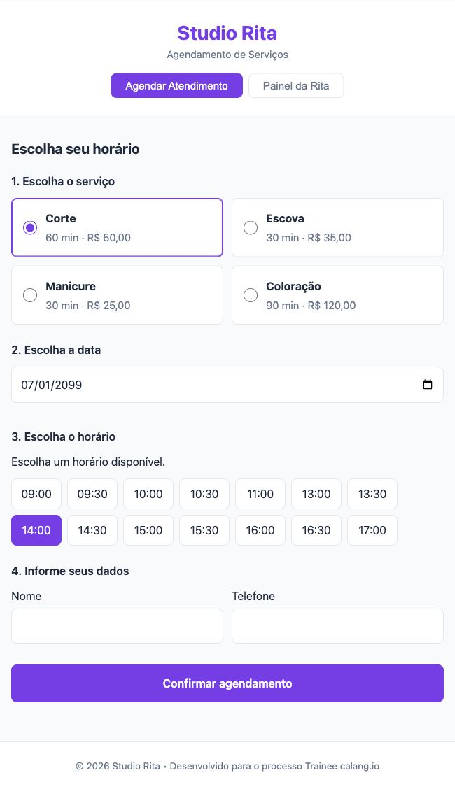
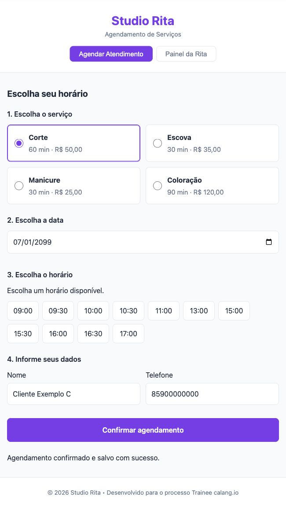
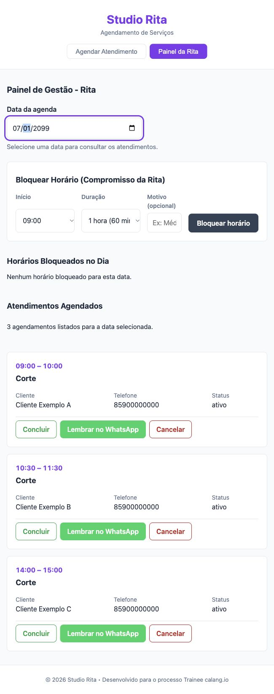
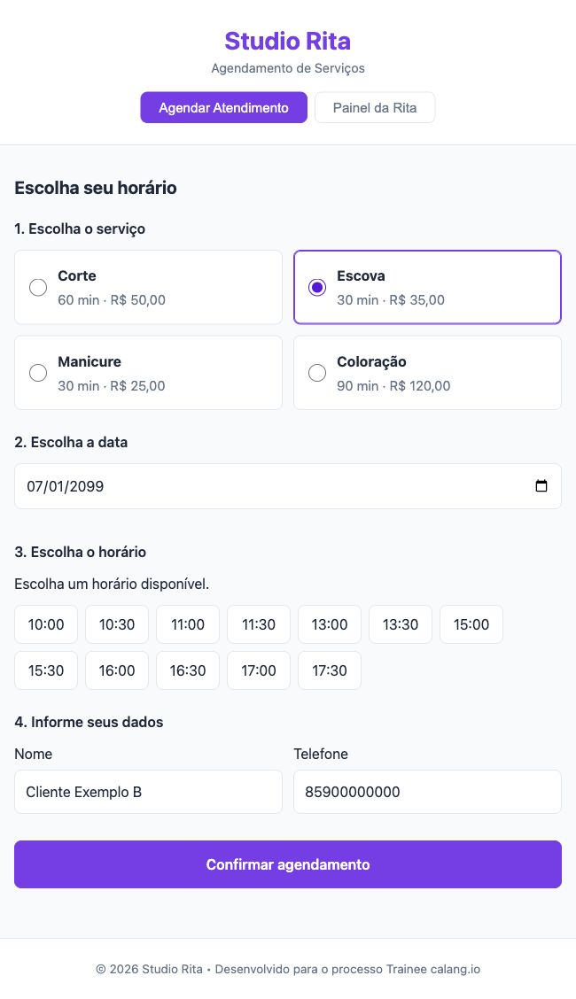
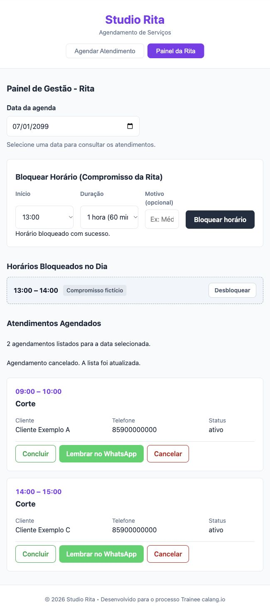
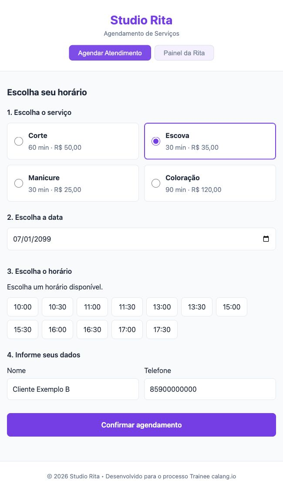
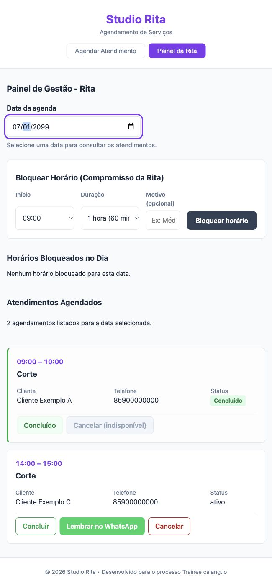
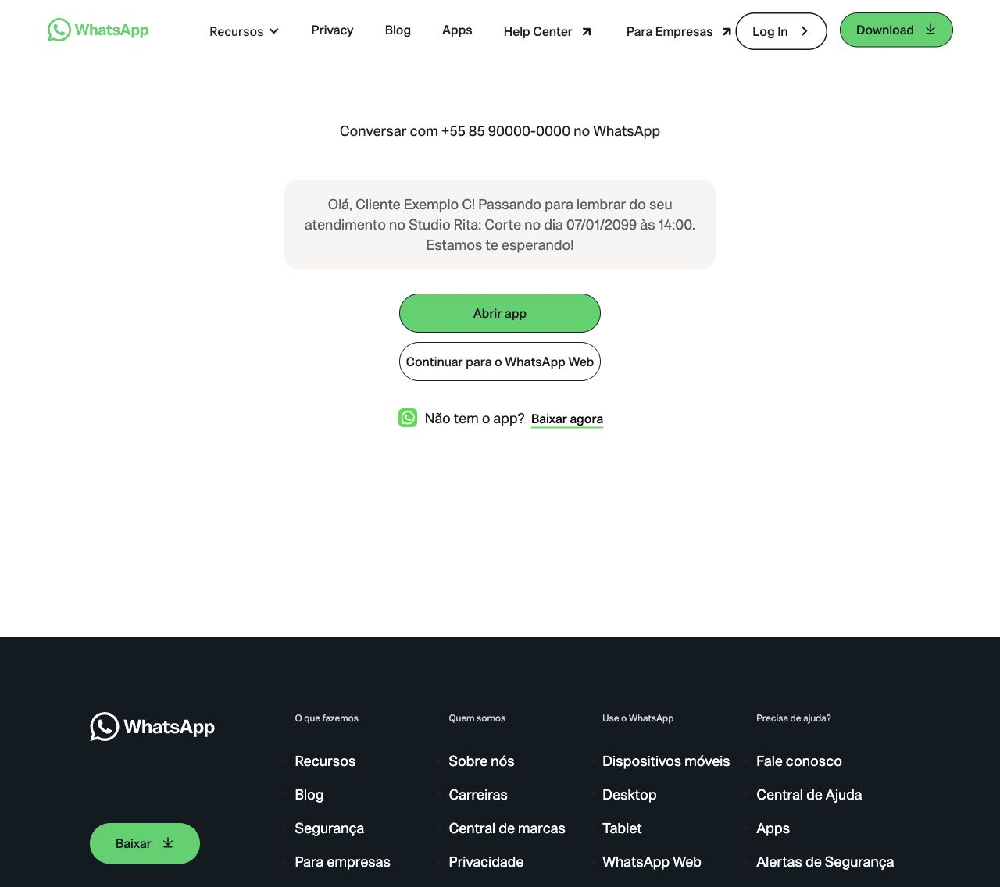

# Studio Rita

Agenda web para clientes escolherem serviço, data e horário e para a Rita gerenciar
os atendimentos do salão. Público-alvo: clientes que desejam agendar pelo navegador
e a profissional responsável pela agenda diária.

A versão funcional integra as issues #1–#6 na main **`87b16f0`**, incluindo os
PRs #10 (Agendar), #11 (Painel) e #14 (diferenciais). Esta documentação corresponde
à issue #7, no PR #13. **A entrega administrativa ainda depende de Pages, conferência
do Kanban e publicação autorizada da tag após o merge deste PR.**

## Equipe

| Integrante | Responsabilidades |
|---|---|
| IagoBNC — Iago | #4: Agendar; #5: Painel e cancelamento; #7: documentação e entrega |
| AmaroJL — Amaro Jr. | #1: estrutura; #2: catálogo/validação/armazenamento; #3: motor e testes; #6: diferenciais |

## Tecnologias

HTML, CSS e JavaScript puro, módulos ES, página única e `localStorage`, sem
framework ou backend. Testes nativos com `node:test` e `node:assert/strict`.

## Instalação e execução

Pré-requisitos: Git, navegador moderno, Node.js com npm para os testes e Python 3
para o servidor HTTP do exemplo. Ambiente verificado: Node.js **v24.22.1** e npm
**11.19.1**. Outras versões não foram validadas nesta etapa.

```sh
git clone https://github.com/AmaroJL/Treinee-calango.io.git
cd Treinee-calango.io
python3 -m http.server 8000 --bind 127.0.0.1
```

Abra [a aplicação local](http://127.0.0.1:8000/index.html). Encerre o servidor com
`Ctrl+C`. Use HTTP, pois os módulos JavaScript não devem ser executados por `file://`.
O package.json não declara dependências externas; não é necessário instalar pacotes.

Na aba **Agendar Atendimento**, selecione serviço, data e horário, informe nome e
telefone e confirme. No **Painel da Rita**, escolha a mesma data para consultar,
cancelar, concluir, criar/remover bloqueios ou abrir o lembrete do WhatsApp.
Os previews em `preview/` são demonstrações isoladas e não substituem a página principal.

## Testes e verificações

```sh
npm test
```

Execução nesta etapa: **37 testes passaram, zero falhas** — dez do motor, nove de
Agendar, onze do painel, seis dos diferenciais e um de inicialização/navegação.
Os testes usam DOM mínimo e armazenamento em memória; alguns cenários usam
respostas controladas. Não equivalem, sozinhos, a testes reais de navegador.

Também foram verificados no navegador: agendar, consultar em ordem, cancelar,
liberar horário, bloquear/desbloquear e concluir mantendo o status após recarga.
A página oficial do WhatsApp abriu com a mensagem preenchida; nenhuma mensagem
foi enviada. Em viewport de 390 px, o painel não teve transbordamento horizontal.
Veja [o registro das verificações e limites](docs/entrega-final.md).

## RF01 a RF08

| RF | Funcionalidade integrada |
|---|---|
| RF01 | Quatro serviços com nome, duração e preço |
| RF02 | Horários por data/duração, segunda a sábado, 09h–18h, almoço 12h–13h |
| RF03 | Validação de nome e telefone, erros por campo e bloqueio de confirmação inválida |
| RF04 | Releitura da agenda e checagem de conflito imediatamente antes de salvar |
| RF05 | Agenda por data em ordem cronológica, com início/término, serviço, nome e telefone |
| RF06 | Cancelamento com atualização imediata e liberação do horário em Agendar |
| RF07 | Bloquear e desbloquear intervalos pelo painel, refletindo a disponibilidade |
| RF08 | Marcar atendimento como concluído e manter o estado após recarregar |

| Serviço | Duração | Preço |
|---|---:|---:|
| Corte | 60 min | R$ 50,00 |
| Escova | 30 min | R$ 35,00 |
| Manicure | 30 min | R$ 25,00 |
| Coloração | 90 min | R$ 120,00 |

O formulário de bloqueio oferece durações de 30, 60, 90 e 120 minutos e motivo
opcional; rejeita conflito e término após 18h. Bloqueios podem ser removidos.
Atendimentos concluídos recebem indicação verde e deixam de oferecer cancelar
ou concluir novamente. Continuam ocupando o intervalo original na agenda.

**Diferencial:** “Lembrar no WhatsApp” abre o link oficial com nome, serviço, data e
horário na mensagem. O envio é manual no WhatsApp. Há uma limitação de normalização
para telefones nacionais de DDD 55, descrita abaixo.

A [matriz de requisitos](docs/requisitos.md) associa funções, PRs e verificações.

## Evidências reais

Capturas da aplicação integrada, com nomes/telefones fictícios e data de teste
07/01/2099. São imagens estáticas do fluxo real, não mockups ou GIFs simulados.

### Selecionar e confirmar




### Consultar, cancelar e liberar




### Bloquear, desbloquear e concluir






### Lembrete



[Índice das 15 capturas e condições dos testes](docs/media/README.md).

## Estrutura

```text
index.html                    Página única e navegação
style.css                     Estilos gerais
src/main.js                   Inicialização e atualização conjunta
src/regras/                   Catálogo, validação e agenda
src/storage/repositorio.js    Operações de localStorage
src/ui/                       Agendar e Painel da Rita, com estilos
tests/                       Motor, telas, navegação e diferenciais
preview/                      Demonstrações isoladas
docs/                         Requisitos, verificação, entrega e capturas
DECISOES.md                   Cinco decisões comparadas
```

## Decisões técnicas

Cinco decisões preservadas: almoço fixo de 12h–13h; minutos para cálculo e
persistência; grade de 30 minutos; lista única de registros; separação entre DOM,
regras e armazenamento. Alternativas, justificativas e consequências estão em
[DECISOES.md](DECISOES.md).

Responsabilidades propostas para confirmação: Iago em D03/D05 e Amaro em
D01/D02/D04, com a data solicitada de 27/10/2026. O histórico não comprova autoria
original individual; a atribuição não é apresentada como fato histórico confirmado.

## Persistência e limitações

Dados ficam no `localStorage` do navegador, na chave `studio_rita_agendamentos`.
**Não há sincronização entre dispositivos/navegadores.** Origens diferentes
(protocolo, domínio ou porta), inclusive localhost e Pages, usam dados separados.
Limpar os dados do site pode apagar a agenda. Não há backup ou backend.

- **WhatsApp e DDD 55:** um número nacional como `55900000000` é tratado como se
  já tivesse DDI. O link fica incorreto para esse caso; informar o DDI completo
  (`+55` seguido de DDD e número) evita essa ambiguidade. Diagnóstico reproduzido
  nesta etapa, sem alteração do código da #6. A validação de telefone exige pelo
  menos oito dígitos, não comprova número existente nem conta WhatsApp.
- O motor não exclui horários que já passaram no dia atual.
- Leitura inválida no repositório retorna lista vazia; uma gravação posterior pode
  substituir conteúdo corrompido. Não há transação atômica entre abas.
- O feedback de bloqueio anterior pode continuar visível após desbloquear; a lista
  e a disponibilidade foram atualizadas corretamente no fluxo verificado.
- Celular físico, leitor de tela e envio efetivo de mensagem não foram testados.

## Publicação e entrega v1.0

**GitHub Pages ainda não está habilitado/verificado. Não há URL de produção
confirmada.** A API informou `has_pages: false`; a conta desta execução tem push,
mas não admin/maintain. Um responsável com permissão deve configurar Settings →
Pages → Deploy from a branch → main → /(root) e validar a URL retornada.

A tag **v1.0 não foi criada ou publicada nesta execução**. A consulta remota não
a encontrou. Deve apontar para o commit definitivo da main após o merge do PR #13,
com autorização explícita antes de publicar.

[Passos exatos de Pages, Kanban e tag](docs/entrega-final.md).
A issue #7 só será concluída após documentação, publicação e tag comprovadas.
